# Student workshop guide: build and test an AI customer

**Start here · Cornell / AuxoAI workshop · November 7, 2026**

This is the guide for the whole day, from the first question to the final report. We'll go one step at a time, together. Ask Codex to do the computer work using the prompts below.

## Before the day: set up your laptop

🧭 **Before the day** · 🕐 About 15 minutes · 👤 On your own · Done this already? Skip it.

**You need:** your own laptop (Mac or Windows), ChatGPT with Codex (you already have access), about 2 GB of free space, and Python 3.10 or newer (3.12 is best). Don't worry about checking: the prompt below makes Codex look and help you install it if needed. No coding experience needed: Codex runs every command for you.

1. **Open** the `student-kit` folder in Codex (open Codex, then choose the `student-kit` folder as your project).
2. **Paste the prompt below into Codex.**
3. Codex should finish with the word **READY**. That's it: you're set for Saturday.
4. If it says **NOT READY**, ask Codex what went wrong and to fix it, then run the check again. Still stuck? Tell a champion when you arrive: we have spare laptops.

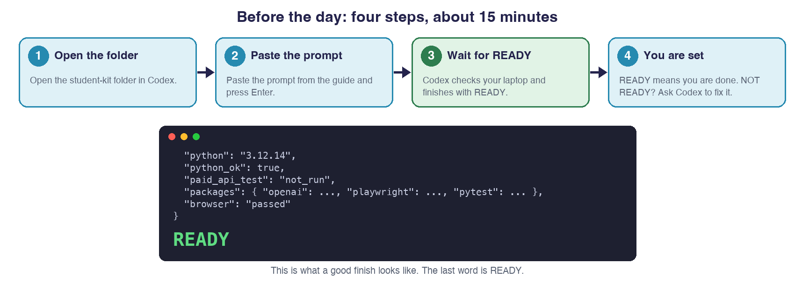

💬 **Say to Codex:**

> Please set up this project for me. First check my Python version: this project needs Python 3.10 or newer (3.12 is best). If mine is older or missing, tell me in non-technical words and help me install Python 3.12 before going on. Then follow the Install section of README.md: create the .venv, install requirements.txt, install the Chromium browser for Playwright, then run preflight.py. Use Windows commands if I'm on Windows. Tell me in non-technical words whether it says READY.

Don't create or save an API key yet, and don't make your own OpenAI account. On the day, your champions will share one key for your team.

## Keep this guide beside your chat

With your student-kit folder open in Codex, ask:

💬 **Say to Codex:**

> Please open docs/student-workshop-guide.html right here in the browser beside this chat.

## If something goes wrong

| What happens | What to do |
|---|---|
| The browser will not open | Ask Codex to check setup and browser permissions. |
| Setup says **NOT READY** | Ask Codex what went wrong and to fix it, then run the check again. Still stuck? Tell a champion when you arrive: we have spare laptops. |
| Python is too old, or an install ends with a long error | Ask Codex: "Help me install Python 3.12, then set up this project again." |
| Setup takes a long time | The first setup downloads a browser and some packages. Wait; it can take several minutes on slow Wi-Fi. |
| Codex asks permission to run commands or use the internet | That's normal during setup. If a request looks unrelated to setting up this project, don't approve it and ask a champion. |
| Your school laptop blocks installs | Tell a champion now: we have spare laptops. |
| Python can't connect to OpenAI, or Codex can't run the Python it set up (a certificate or SSL error, often on Windows with antivirus software that checks web traffic) | Ask Codex: "My Python can't connect to OpenAI. Check whether it's a certificate error, possibly from my antivirus, and fix it using the Windows trusted certificates. Explain what you changed in non-technical words." It took a tester only a few minutes. Still stuck? Tell Arnav or a champion. |
| A run stops with "No such file or directory: .env" | The `.env` file doesn't exist yet. Ask Codex: "Create .env from .env.example. Don't read or show my key." Then open it and add your key yourself (Step 2). |
| The key is rejected | Check it locally; never paste it into chat. |
| The API says "rate limit" or "too many requests" | Many laptops are using the AI at once. Wait a minute, then run it again. Don't change the key or the settings. |
| The API reports exhausted credits | Tell a champion. Repeating requests won't add credits. |
| The AI reads or clicks something incorrectly | Save the evidence and label it an agent error. |
| A real website blocks access | Record the access problem and stop that attempt. |
| Safety and execution blocks an action | Record the restriction; keep the safety rules unchanged. |
| A Samsung or Apple run stops early | Open the dropdown in Step 7 and run the prompt there. |
| The run stops halfway | Ask Codex to inspect the saved checkpoint and explain whether to resume. |
| The report invents a detail | Remove or correct the claim using the saved evidence. |
| A key ends up where it shouldn't | Tell a champion straight away. They'll replace it. |

## Three habits to keep

**Before anything else, three habits.** Today you'll build things, and some of it may not work. That's fine. If you only take three things home, take these. They work with or without an agent, and we'll keep coming back to them all day.

1. **Ask a good question, then keep asking.** Know what you want to find out before you start. Then keep asking yourself as you go. ❌ "Is dell.com good?" ✅ "Where do first-time buyers get stuck?"
2. **Guess first, then look.** Say what you think will happen, then run it. Wrong guesses are the useful ones: that's where you learn something. ✏️ "I think the price will be easy to find." 👀 It took 6 clicks.
3. **Check it, don't just trust it.** AI sounds just as sure when it's wrong. Look at the proof yourself. 🤖 "Checkout was confusing." 🔍 Open the screenshot. Was it?

If the build goes sideways, or the agent stops making sense, these still hold. You can do all three with nothing but a browser and a notebook.

## Before we start: what today is, and isn't

**The case.** Imagine you're a business analyst on Dell's online team. Dell sells laptops on dell.com, and when a shopper gets confused or stuck, they usually leave without buying. Your job is to find out whether dell.com is easy to buy from, and where it isn't. Dell has one question for you: *Where do our customers struggle to buy a laptop on dell.com, compared with a competitor, and what should we fix first?*

**How you'll find out.** Dell can't watch thousands of real shoppers today. So you'll use an AI customer: a made-up shopper you describe, who browses dell.com and one competitor and tells you where it got stuck. Think of a mystery shopper that finishes in minutes. By the end of the day you'll have built the core of the AI that does the shopping, and you'll use it to answer Dell's question.

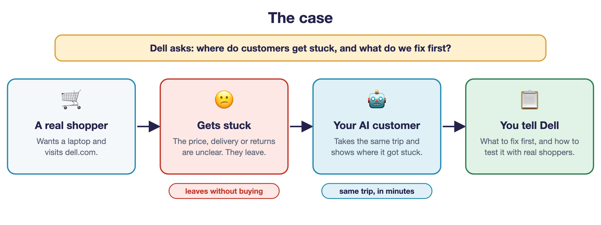

**How we get there: one small question at a time.** Each section is a question with a short answer. Tick it off when you can say the answer in your own words.

**What "building an agent" means today.** You won't build a whole agent from scratch, and you don't need to. With Codex, you'll build its first three parts: it **sees** a page, **decides** what your customer would do, and **acts** once, safely. We give you the rest: the safety rules, the loop and the report. Codex writes the code. You direct it and check it.

**Good to know.** Your AI customer is made up, so what it says is an idea to test with real people, not a fact. Please don't post it. Nothing gets bought. The AI will sometimes get things wrong, and spotting that is part of your job. Dell, Samsung and Apple aren't involved.

## How to use this guide

**How each section works.** Read the question, do the steps with Codex, then say the answer in your own words and tick it off. Before each action, guess what will happen. Stuck or curious? Ask Codex "why did you do that?", then your partner, then a TA. Working out what to ask is the skill we're practising today.

**Something not working?** Open **If something goes wrong** near the top of this guide first. It has a search box: try a word like *key*, *browser* or *credits*. New word? The [glossary](glossary.md) explains each one.

**Do this once, now.** Paste this into Codex so it explains as it goes, then use the short prompts below:

💬 **Say to Codex:**

> As we go, tell me what we’re about to do and why, and what happened afterward, in non-technical words. Keep it short and relaxed. Never read or show my API key.

**Last thing before we begin:** open your unzipped student-kit folder in Codex. In this guide, file paths are relative to that folder.

## What does Dell want to know?

💡 **Why we ask:** Every study starts with a question someone needs answered. Everything we do today is to answer this one.

You'll give the agent a **persona**: a description of the customer and what they need. The AI looks at a website, picks what to do next, and tries to answer that customer's questions. It saves screenshots so you can check its work.

We start in two made-up laptop stores. Why? We know what's on those pages, so it's easy to spot when the agent misreads something, and nothing on a real site can get in the way. What it finds there says nothing about Dell or its competitors.

Then we try Dell and one competitor. At the end, the AI drafts a report, and **you decide whether its claims match the evidence**.

**Your job** is to design the study and check the results. **The persona** describes the customer. **The agent** browses within the rules and saves what it sees.

### Try it by hand first

Before we open Codex, let's do the job ourselves. I'll go first, out loud: first as a customer shopping for a laptop on dell.com, then as the Dell analyst working out what to look at.

Then you try, for a few minutes. Pick a laptop on dell.com like you're the customer. Just look: don't sign in and don't buy. Jot down what you wanted to know, where you went, and where you got stuck.

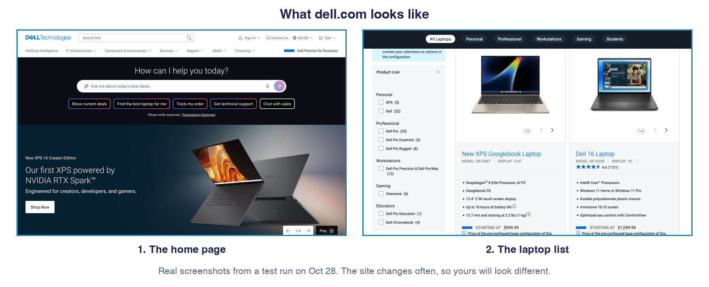

**My notes from shopping by hand**

- **What I wanted to know:**
- **Where I went:**
- **Where I got stuck:**
- **As the Dell analyst, what I'd look at first:**

Keep those notes. Everything we build today is a way to hand this same job to an AI. The best builders right now aren't the ones who write the most code. They work out what to ask, and let the tools help with the rest.

🧠 **Habit 1: ask a good question, then keep asking.** Look at your notes: they started with something you wanted to know, and you kept asking as you went. Was your first note a question as sharp as the one in the habit card?

### Now watch an AI do the same job

Now watch an AI do what you just did by hand. We'll play a short screen recording of an agent shopping dell.com, then look at one step of its replay and the report it drafted. This is a real test run, so yours will look a bit different: the AI makes different choices each time. As you watch, notice where it looked first, what it clicked, and what it said it couldn't find.

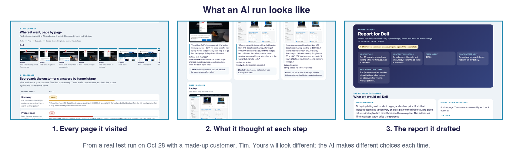

☑️ **Answer:** *What does Dell want to know?* Where an AI customer like ours gets stuck, confused or leaves while shopping for a laptop on dell.com compared with a competitor, and what Dell should look at first. These are ideas to test with real customers, not facts about them.

🎯 **The takeaway:** **Know what you're trying to find out first.** If you can't say it in one sentence, you won't know when you've found it.

## What are the five parts of our agent?

💡 **Why we ask:** Your slides covered what an agent is. These are the five names we'll use all day.

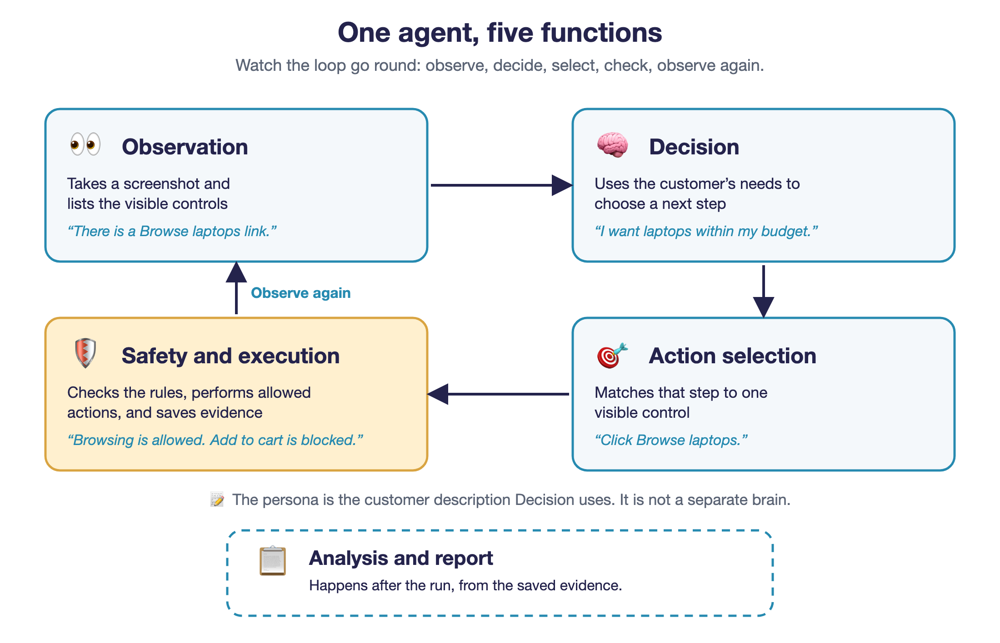

| Function | Its job | A simple example |
|---|---|---|
| **Observation** | Takes a screenshot and lists visible controls | “There is a Browse laptops link.” |
| **Decision** | Uses the customer's needs to choose a next step | “I want to see laptops within my budget.” |
| **Action selection** | Matches that next step to a visible control | “Click Browse laptops.” |
| **Safety and execution** | Checks the rules, performs allowed actions, and saves evidence | “Browsing is allowed. Adding to cart is blocked.” |
| **Analysis and report** | After the run, uses the saved evidence to draft a report | “The total price was still unclear at this step.” |

The **persona** is the customer description that Decision uses. It's not a separate brain.

▸ **Optional: try a one-question activity on how an agent decides.**

**Try the activity:** [What is an agent?](../learning-activities/04-agent-loop.html). Choose an action and watch Safety and execution allow it or block it.

💬 **Say to Codex:**

> Open learning-activities/04-agent-loop.html in my browser. Let me finish the activity, then explain the result using our workshop glossary. Do not recreate or change the activity.

It runs offline and asks one question.

<!-- /optional -->

☑️ **Answer:** *What are the five parts of our agent?* Observation, Decision, Action selection, Safety and execution, and, after the run, Analysis and report. Together they make one agent that uses an AI model to choose its next step toward a goal, within rules.

🎯 **The takeaway:** **An agent does three things over and over: it looks, it decides, it clicks.** When something goes wrong, you can work out which one it messed up.

## What is my agent not allowed to do?

💡 **Why we ask:** Before your agent clicks anything on the web, we decide what it must never do.

Your agent plays by a few strict rules. **Safety and execution** enforces them in code, so they hold on every run. In short: your agent can look around, but it can't buy anything or type in personal details.

![What your agent can and can't do. It can visit the approved sites (the practice stores, then Dell and your competitor), click links and product options to read pages, type in the product search box and the study ZIP code 10001, and stop and write down what happened when a page blocks it. It can't visit any other website, add to cart, check out, sign in, sign up, pay, subscribe or download anything, type anything else such as names, emails, addresses or card details, or work around a bot check or an access gate. Limits: 12 steps per task, 10 minutes per site, 3 failed actions in a row](images/can-and-cant.png)

It also has limits: up to 12 steps per task, 10 minutes per site, and a task stops after 3 failed actions in a row.

If a rule blocks your agent, the system is doing its job. It's not a bug. Write it down as a **runner restriction** (our rules stopped it, not the website and not the AI) and carry on. Never loosen a rule to get past a block. Step 5 shows how to label every kind of problem.

One thing that looks risky but isn't: on some stores, prices sit behind a link like **Buy** or **Shop**. If it only opens a page that shows prices, nothing is bought, and your agent may follow it. Adding to a cart is the line it never crosses.

☑️ **Answer:** *What is my agent not allowed to do?* It cannot buy anything, sign in, download, type personal details, visit other sites, or get around a bot check. It stops and writes down what happened.

🎯 **The takeaway:** **Set the rules before you hit go.** Our agent can click around on its own, so we tell it what it can never do first. That's way easier than fixing a mistake after it happens.

## Your route through the numbered steps

Colour shows who does each step; dashed means optional.

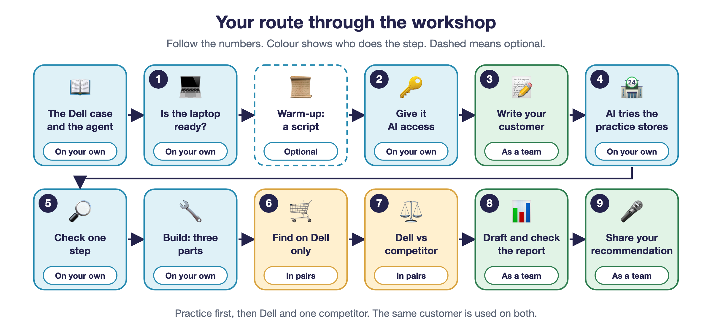

## Step 1. Is my laptop ready?

🧭 **Morning** · 👤 On your own

💡 **Why we ask:** Everything today runs on your laptop, so we check it first.

You did this before the workshop. Run it once more so we know today's laptop is still ready. Haven't set up yet? Open **Before the day** at the top and do it first.

💬 **Say to Codex:**

> Check the project setup and run preflight. Don’t read or show my API key. Explain the result in non-technical words.

✅ **What should happen:** the setup check ends with `READY`. This means the installed tools and browser work. It does not yet prove the AI works.

☑️ **Answer:** *Is my laptop ready?* Yes. The setup check ends with READY, which means the installed tools and the browser work. It does not yet prove the AI works; Steps 2 and 4 test that.

🎯 **The takeaway:** **Check your setup before you build anything.** A lot of "it's broken" turns out to be "I never set it up right."

## Warm-up (optional): what can a plain script not do?

🧭 **Warm-up** · 🕐 Morning · 👤 On your own · Optional: if the clock is tight, skip to Step 2.

💡 **Why we ask:** Seeing what a plain script can't do shows why we need an agent.

Before you build an agent, see what a plain script can't do. It's quick and doesn't need a key.

💬 **Say to Codex:**

> Write a Python Playwright script that opens the local mock laptop store (store-a), then clicks Browse laptops, View laptop details, Specs and delivery, and Returns and warranty in that order, saving a screenshot of each page. Only allow the local server. Don't use any AI. Run it on store-a, then run the same script on store-b. Explain the result in non-technical words.

✅ **What should happen:** you get two sets of screenshots, one per store, taken by exactly the same steps. The script visited both stores in the same way.

Now open the two “Specs and delivery” screenshots side by side. Look at what each page says about the processor, the battery, delivery and tax.

**Check yourself:** The script treated both stores the same. What can't it tell you? (Think about which store a customer would find clearer, and how you would know.)

That is the gap an agent fills. It reads what is on the page, decides what your customer would do next, and acts. You will build one in a few steps.

## Step 2. How does my agent get access to the AI?

🧭 **Before lunch** · 👤 On your own

💡 **Why we ask:** The agent's thinking happens in an AI service, and it needs a private key to use it.

An API key is a private pass that lets this program ask an AI service for help.

🔐 **Treat your key like a company password.** A key can spend money and act as you. At a company like Dell, a leaked key can mean a surprise bill or exposed customer data. ✅ **Lives in:** `.env` on your laptop ❌ **Never in:** chat · messages · slides · screenshots · reports · code *Seen a key somewhere it shouldn't be? Tell a champion straight away.*

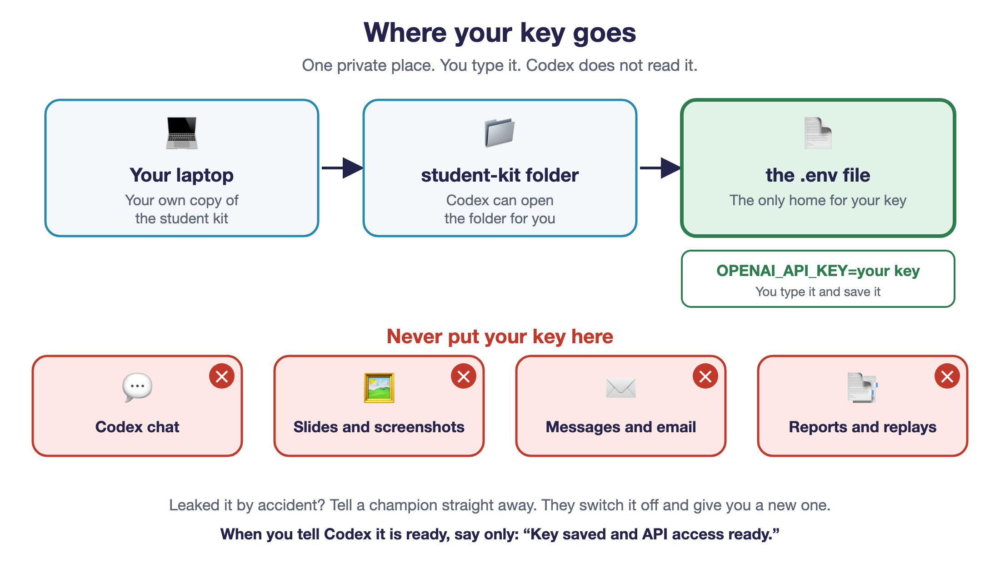

First, get your bearings in the project:

💬 **Say to Codex:**

> Show me the main project folders in a table with three columns: Folder, What it holds, and A simple example. Explain it in non-technical words, like I’m new to coding.

✅ **What should happen:** Codex lists the main folders and what each holds.

Then open the key file:

💬 **Say to Codex:**

> Open the .env file so I can add my key myself. If it’s missing, create it from .env.example. Don’t read or show my key. Explain the result in non-technical words.

✅ **What should happen:** the `.env` file opens. You enter and save the key yourself. Opening the file for you does not give Codex permission to read its contents.

1. Your team gets **one key to share**. Your champions will share it in a private file: copy it from there. Don't create a key of your own.
2. Open `.env`. Put the key after `OPENAI_API_KEY=`, replacing `replace-locally`, then save.
3. Ask a champion to confirm your key has credit. Never add your own money to a workshop key.
4. Tell Codex only: **“Key saved and API access ready.”**

☑️ **Answer:** *How does my agent get access to the AI?* Through a private key our team shares for the day. Each of us copies it into our own `.env`, and nowhere else, never in chat.

🎯 **The takeaway:** **A key is like a password that costs money.** Keep it in one private spot and never paste it in chat.

## Step 3. Who is our customer?

🧭 **Mission and persona** · 👤 On your own

💡 **Why we ask:** Dell can't interview thousands of shoppers today, so your agent pretends to be one customer you describe.

Our starting customer is **Jordan**, who is starting a first job in New York. Jordan needs a new laptop for spreadsheets, video calls, and everyday work, with a budget of **$1,500 including tax and delivery**. Jordan dislikes technical jargon and unclear costs.

Now write your own. Make up a shopper who needs a new laptop, with their own needs, budget and dislikes. Use Jordan as the model, but change the details. Keep it a made-up person: no real names, emails or personal details, and not yourself. Give them a total budget between $1,200 and $2,000, so Dell has laptops to find. Save it in a new file, `personas/our-persona.md`, beside `persona-template.md`. Keep the template as it is. Codex can create and open the file for you.

💬 **Say to Codex:**

> Create personas/our-persona.md beside personas/persona-template.md, starting with Jordan’s five fields. Keep the template unchanged and preserve any persona I already wrote. Open our-persona.md so I can edit it. Explain it in non-technical words.

Look at your notes from earlier, when you shopped by hand: who you were, what you needed, your budget, what mattered, what made you want to leave. Those are the five fields. Once it opens, edit them until they describe your shopper: **who, need, total budget, priorities, and reasons to leave**. Save the file. You can add the optional sixth field for one extra question of your own.

✅ **What should happen:** you have a made-up customer with a clear need, a budget, must-haves, and reasons to leave. You'll use your own persona for the practice run and the build. For Dell and the competitor, your team will pick one persona to use, so the comparison is fair.

### Your customer will fill in a short survey

After each store, your customer answers four quick questions, like a survey on the way out the door. Each one points at a place where Dell could lose a customer. Here they are, exactly as your customer is asked, with made-up example answers from Jordan so you can see the style:

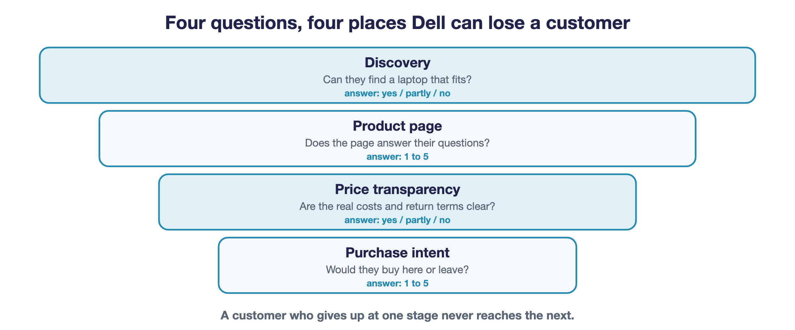

| Stage | What your customer is asked | Example answer from Jordan (made up) |
|---|---|---|
| **Discovery** | Did you find a product that fits your needs and budget? Which one, and at what price? | "Partly. I found a laptop that looks right, but I can't tell if tax and delivery keep it under $1,500." |
| **Product page** | How confident are you that it meets your must-haves? What was missing or unclear? | "3 out of 5. The speed and screen are listed, but I couldn't find how long the battery lasts." |
| **Price transparency** | Do you know the total cost, including tax and delivery, and the return terms? What couldn't you find? | "No. I couldn't find the delivery cost or the return terms." |
| **Purchase intent** | How likely are you to buy here rather than leave? What one thing would change your mind? | "2 out of 5. I'd stay if I could see the full price up front." |

Discovery and Price transparency are answered yes, partly or no. Product page and Purchase intent are a number from 1 to 5. If you added the optional sixth field to your persona, your customer answers that extra question too. Jordan's answers are made up. Yours will differ, which is why you guess first.

🧠 **Habit 2: guess first, then look.** Say what you expect before you see what happens. The gap between the two is where you learn.

**Predict first.** Before you run anything, say out loud how you think your customer will answer at the first store. Tell your partner. No writing needed.

☑️ **Answer:** *Who is our customer?* A made-up shopper I describe in five fields, saved in `our-persona.md`, who answers a four-question survey after each store. I also guessed how they will answer.

🎯 **The takeaway:** **Your results are only as good as your customer.** If you describe them in a fuzzy way, you get fuzzy answers back.

## Step 4. What does the AI do when it shops as our customer?

🧭 **Practice, before the build** · 👤 On your own

💡 **Why we ask:** You've got a customer. Let's watch an AI shop as them before we build anything.

These practice stores are made up and run on your computer. They let us check the AI before we try real sites.

⚠️ **Check first:** say your persona's name and total budget out loud. The run uses whatever is saved in `personas/our-persona.md` right now, so check it before you start.

💬 **Say to Codex:**

> First read back my persona’s name and total budget (not my key). Then run the real AI on the practice stores as that persona: the customer in personas/our-persona.md, or Jordan if I haven’t written one yet. Use my local .env and a visible browser. When you explain what it saw, decided, selected and was allowed to do, use the workshop glossary names. Then open the replay. Don’t show my key. Explain the result in non-technical words.

✅ **What should happen:** a browser opens, the AI tries the tasks as your persona, and the run is saved in a folder inside `outputs/`. Open `report.html` in that folder: the replay shows who the customer is, what happened in each store, the scorecard, and every step.

The three tasks are:

1. **Find:** find a new laptop and read its exact name and price.
2. **Evaluate:** check its specifications and whether it meets the customer's needs.
3. **Decide:** look for delivery, returns, fees, and warranty information, then explain whether the customer would continue or leave.

An honest “I could not find it” is useful.

**Now compare:** open the **Scorecard** in the replay. That is your customer's survey, in its own words. Put it next to the guesses you wrote in Step 3. These are the AI customer's own answers, so check them against the screenshots.

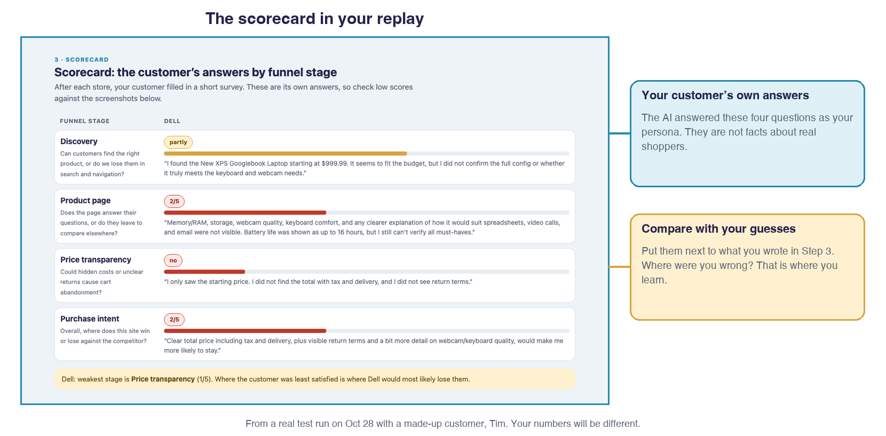

🧠 **Habit 2 again: compare with your guess.** Where did the AI surprise you? That gap is the lesson.

- **Where it surprised us:** 

☑️ **Answer:** *What does the AI do when it shops as our customer?* It sees the page, decides what our customer would do, clicks, and fills in the survey. Everything is saved in a replay.

🎯 **The takeaway:** **Watch it work once before you trust it.** It's hard to judge something you've never seen do its job.

## Step 5. How do we know if it did a good job?

🧭 **Practice, before the build** · 👤 On your own

💡 **Why we ask:** An AI can sound sure and still be wrong, so we check one step against the evidence.

Open the replay. Pick one step and ask:

- **Observation:** What was actually visible in the before screenshot?
- **Decision:** Did the proposed next step make sense for this customer?
- **Action selection:** Did it choose the correct visible control?
- **Safety and execution:** Was the action allowed, and what happened afterward?

💬 **Say to Codex:**

> Show me one replay step: what the AI saw, chose, and did. Use the replay for the screenshots, the action and the safety check, and run.json for the full list of controls that were visible. Also tell me which persona name and total budget this run used. Help me tell an AI mistake from a website problem or a blocked action. Explain the result in non-technical words.

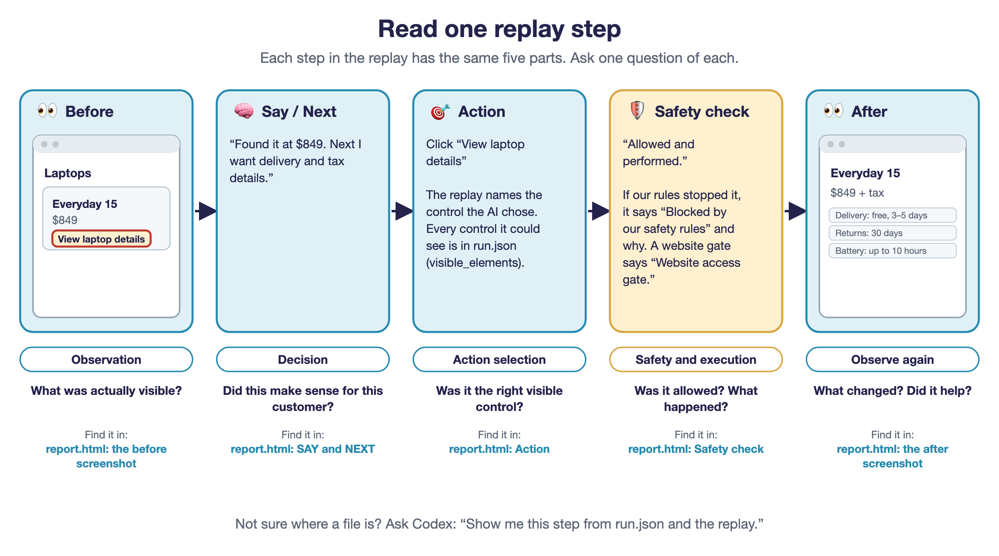

**Where to look:** scroll to **Step by step** at the bottom of the replay. A red ring marks the control the AI chose. Each step shows the screenshots, what the AI said, its next step, the action, and the safety check (allowed, blocked, or could not be performed). The full list of visible controls is in `run.json` in the same folder. You'll see `dell-` and `samsung-` in the file names, even for the fictional stores: those are just the study's two slots.

✅ **What counts as a good checkpoint:** you can explain one complete step and point to its evidence. If the AI misreads a price or clicks the wrong link, record it as an agent error. If our safety rules block content (see **What is my agent not allowed to do?**), record it as a runner restriction.

🧠 **Habit 3 in miniature:** you're not taking the AI's word for it. You're opening the screenshot and looking.

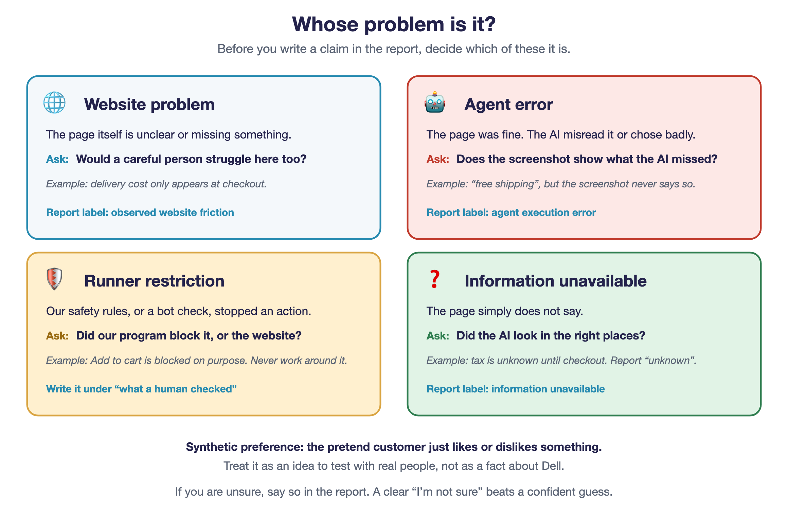

☑️ **Answer:** *How do we know if it did a good job?* By checking a step against its screenshots: was it the AI's mistake, the website's, or a rule?

🎯 **The takeaway:** **Don't just believe what the AI says. Look at the screenshot.** If something went wrong, figure out who messed up: the AI, the website, or one of our rules.

## Build: can I make a piece of the agent myself?

🧭 **Build** · 🕐 Build block · 👤 On your own, with your partner beside you

💡 **Why we ask:** Building the first parts shows you what's under the hood.

Look back at what you did by hand: you looked at the page, decided what to do, and clicked. Those are the three parts you build now. The provided engine adds the loop and the report, so you're not building everything from scratch.

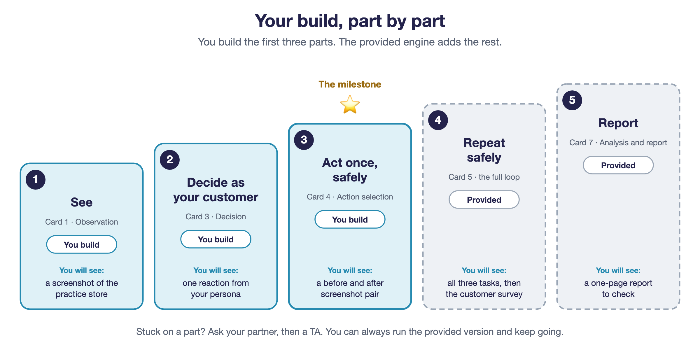

The three parts take about an hour: part 1 is the quickest, part 3 the longest. Paste each prompt into Codex, let it run, then check what you got. Stuck? Ask your partner, then a TA. At the halfway check-in, if you're not at part 2 yet, run the provided version named under the part and keep going. When the block ends, everyone moves on to the live run, finished or not.

🧠 **If the build gets messy, keep the habits.** You can lose the thread on how the code works and still do all three: ask what you're after, guess what will happen, check what actually did. That part carries over to any tool you pick up later.

### Part 1. Can my agent see a page?

You are building **Observation**: a small script that opens a practice store and takes a picture of what is on screen. Everything your agent does later starts from this picture.

💬 **Say to Codex:**

> Create a Python Playwright script that opens the local mock laptop store and saves a 1280×800 screenshot of what's visible. Only allow the local server. Explain the folder structure. Then run it.

✅ **What should happen:** a readable screenshot of the Northwind Computers store appears in your folder.

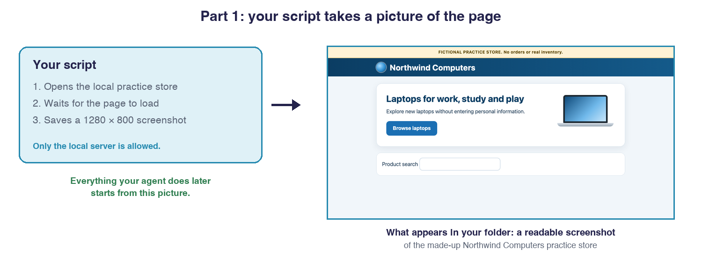

⚠️ **If it doesn't work:** show Codex the error message and ask it to fix it. Still stuck? Open the provided version: `research_agent/browser.py` (`observe`) and `practice.py`.

### Part 2. Can it decide what our customer would do?

You are building **Decision**: it sends that screenshot and your persona to the AI and gets back how your customer reacts and what they would do next. This part needs your key saved in `.env` (Step 2) and credits on the account.

💬 **Say to Codex:**

> Read our persona from personas/our-persona.md. Send the screenshot and the persona to the model using the API key from the .env file, and ask for a structured answer: reaction, feeling, one next step, evidence, uncertainty, and whether a product is selected. Don't send hidden page code. If there's no key, stop with a clear message. Then run it once.

✅ **What should happen:** you get one structured reaction: how your customer feels, one next step, what they saw, what they're unsure about, and whether they've picked a product. No key? You'll see a clear “missing key” message instead.

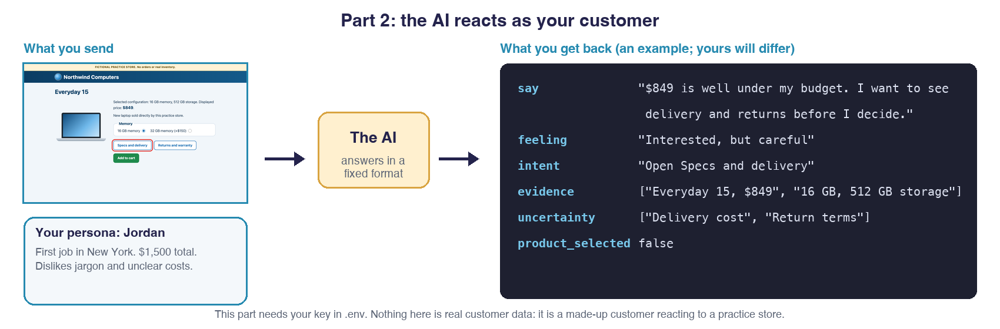

⚠️ **If it doesn't work:** “missing key” means check Step 2 (the key goes after `OPENAI_API_KEY=` in `.env`). If the API says credits are exhausted, tell a champion; repeating the request will not add credits. Still stuck? Open the provided version: `backend.py` (`persona`) and `models.py`.

### Part 3. Can it act without breaking a rule?

▸ **Optional: read the safety rules in the code and run their tests.**

First, read the rules. **Safety and execution** is provided, so you do not write it: you read it and run its tests. The short list is in **What is my agent not allowed to do?**.

💬 **Say to Codex:**

> Show me Safety and execution (the Policy) in research_agent/browser.py in plain English: which actions does it allow, and which does it refuse? Then run its safety tests with pytest and tell me what passed.

✅ **What should happen:** the tests pass: the catalog link works and every forbidden control is refused.

**Check yourself:** Why do the rules live in code instead of in the AI's instructions?

<!-- /optional -->

Build **Action selection**: it picks one control to click, passes it through Safety and execution, and saves a new screenshot.

💬 **Say to Codex:**

> Add Action selection: a second call that sees the screenshot, the customer's next step, and the list of visible elements, and returns one action. Run that action through Safety and execution and save a new screenshot. Refuse targets that changed. Run one step.

✅ **What should happen:** you get a before and after screenshot pair. That is the milestone ⭐: your agent has seen, decided and acted once, safely.

⚠️ **If it doesn't work:** ask Codex what blocked the action, and do not loosen the rules to get past it. Still stuck? Run the provided one-step loop in `runner.py` and keep going.

**Check yourself:** Which part chooses what to do, and which part does it?

### What you have built

You now have an agent that sees, decides and acts once, safely. The provided engine repeats that for Find, Evaluate and Decide (part 4), asks your customer the survey at the end, and writes the report (part 5). That is what you will run in Steps 6 to 9.

☑️ **Answer:** *Can I make a piece of the agent myself?* Yes: it can see a page, decide as our customer, and act once, safely.

🎯 **The takeaway:** **You don't have to build the whole thing to get it.** Making one small piece shows you how the rest works.

## Step 6. Can the agent find a laptop on Dell?

🧭 **Live run** · 👥 In pairs

💡 **Why we ask:** Let's start small on the real site, with one task.

**First, pick one persona as a team.** Each of you wrote your own. Choose the one that makes the best test (a clear need and budget, with something that could trip up a website), and copy its five fields into the `our-persona.md` on every laptop that will run Dell or the competitor. Everyone then uses the same customer for Steps 6 to 9, so the comparison is fair.

Try only **Find** on Dell. Wait until it's your table's turn: if every laptop starts at the same second, the AI service slows down for everyone.

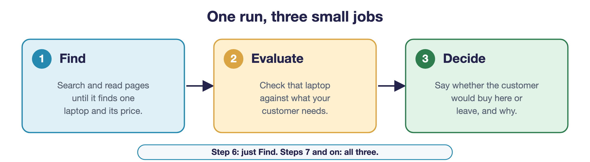

💬 **Say to Codex:**

> Run only Find on Dell with the real AI, our persona, my local .env, and a visible browser. Keep the safety rules unchanged, then show me the replay. Explain the result in non-technical words.

✅ **What should happen:** the agent attempts to find one new laptop and read its model and price. If tax or delivery is missing, it should say total affordability is unconfirmed.

⚠️ **If Find doesn't finish:** on Dell's real site, Find sometimes uses all 12 steps without settling on a laptop, often because the agent opens one far over budget and stays there. That's a real result, not your mistake. Read the last few steps of the replay to see where it wandered, then run Find once more. If it happens again, keep the result, write it down as an agent error, and carry on: the comparison still works.

⚠️ **Watch out:** if the website blocks access or shows a bot check, stop and record that. Never bypass it or loosen the safety rules.

☑️ **Answer:** *Can the agent find a laptop on Dell?* It tries to find one laptop and its price. If tax or delivery is missing it says the total is unconfirmed, and if the site blocks it we record that and stop.

🎯 **The takeaway:** **"I couldn't find that" is a fine answer.** It's way better than guessing and being wrong.

## Step 7. How does Dell compare with a competitor?

🧭 **Live run** · 👥 In pairs, then share with your team

💡 **Why we ask:** Dell's question is a comparison, so we use the same customer in two stores.

After reviewing the Dell Find attempt, your pair runs Find → Evaluate → Decide on one store, with your team's chosen persona and the same AI model as the other pair.

For the workshop, Pair A runs Dell. Pair B runs the competitor: Samsung for odd-numbered teams, Apple for even-numbered teams.

Two tips. Samsung loads its laptop list a moment after the page opens, so give it a second. On Apple, prices may sit behind a link like **Buy**. If the agent keeps scrolling without finding a price, suggest that link, and check that the page it opens only shows prices.

▸ **Samsung or Apple run stopped early?**

Sometimes the agent stops because a page has a **Buy** button and our safety rules play it safe. That's not your mistake. Try again with this:

💬 **Say to Codex:**

> Show me the last few steps of the replay for this run and tell me where it stopped and why. Don’t change any safety rules. Then run the same task again. Explain the result in non-technical words.

Still stops? Keep the result, write it down as a runner restriction (our rules stopped it), tell a helper, and carry on with what you have.

<!-- /optional -->

💬 **Say to Codex:**

> First, ask me two questions, one at a time: "What is your team number?" and "Are we Pair A or Pair B?" Wait for my answers. If we are Pair A, we run Dell. If we are Pair B, we run our competitor: Samsung if the team number is odd, Apple if it is even. Tell me which store we are running before you start, and don't guess. Then run the full study on that one store, using the same persona and AI model, my local .env, and a visible browser. Review the run with me. Explain the result in non-technical words.

Pair B shares its whole run folder with Pair A for the combined report, and can export a one-file copy of its replay (see Step 9) so Pair A can read the story quickly. Keep screenshots with the replay.

After each store, your customer fills in the same four-question survey from Step 3. Those answers are the AI's own account of what it saw, so check them against the evidence.

**Now compare the two stores.** When both runs are done, open the two replays side by side. Fill in what your customer answered at each store, then find the biggest gap:

| Survey stage | Dell | Competitor |
|---|---|---|
| Discovery (yes / partly / no) | | |
| Product page (1 to 5) | | |
| Price transparency (yes / partly / no) | | |
| Purchase intent (1 to 5) | | |

**Biggest gap:** which stage differs most, and what do the screenshots show about why? That is the first thing Dell should look at.

☑️ **Answer:** *How does Dell compare with a competitor?* We run the same customer on both, put the four survey answers side by side, and find the biggest gap and what the screenshots show behind it.

🎯 **The takeaway:** **One result doesn't tell you much.** Put two side by side and you can finally see what's different.

## Step 8. Can we trust what it found?

🧭 **Analyse** · 👥 As a team

💡 **Why we ask:** The AI writes fast and sounds sure. Checking it is the analyst's job.

**Short answer: not yet.** The AI can read two stores and write a clean-looking report in about a minute. That is its strength. Its weakness is that it sounds just as sure when it is wrong as when it is right. In our own test runs it:

- named a screenshot that did not show what it claimed;
- picked a "weakest stage" that its own scores did not back up (the two stores had tied there);
- said delivery and return terms were "not found", when our own safety rules may have blocked the page request that holds them.

If we'd sent any of that to Dell unchecked, we'd have told them something wrong. So the AI does the slow part (browsing, saving evidence, drafting), and **you do the part that needs judgment: deciding what the evidence really supports.** Checking is quick, because every claim points to its step and its screenshot.

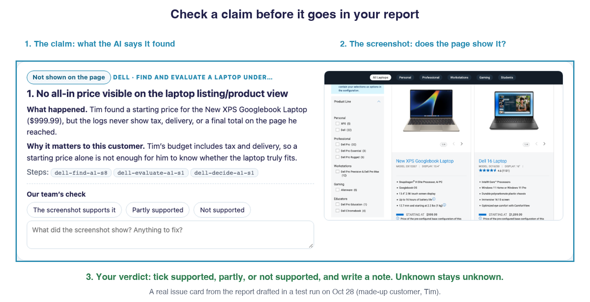

🧠 **Habit 3: check it, don't just trust it.** The five steps below are this habit, written out.

💬 **Say to Codex:**

> Use real AI to draft a report from our Dell and competitor runs with my local .env. Open analyst-report.html and help me check its claims against the evidence. Explain the result in non-technical words.

✅ **What should happen:** the analysis step writes a report as a web page, `analyst-report.html`, with a PDF copy. It covers the customer, the scorecard, website issues, the competitor comparison, agent errors, a recommendation, and limitations. For each website issue, you can tick whether the screenshot supports it.

### Check it in five steps

Split these up across your team.

1. **Read the top of the page.** "The answer in one screen" is what the AI wants to tell Dell. Say it out loud in one sentence. Is that really what you saw in the replay?
2. **Open each website issue's screenshot.** Does it show what the card says? Click **The screenshot supports it**, **Partly supported** or **Not supported**, and write one line saying why.
3. **Check the numbers.** Do the bars match what the customer answered? If the page's "biggest gap" and the AI's own pick of weakest stage are different, decide which one the screenshots support.
4. **Sort out whose problem it is.** In "Not the website's fault", ask of each item: is it the website, the AI, or our own safety rules (see Step 5)? A price or delivery date marked "not found" is a **question to check**, not proof that the site hides it.
5. **Check the recommendation.** Can you back it with a screenshot? Does it say how we would test it with real customers? Cut anything you cannot back, or mark it as unknown.

Your ticks and notes are saved in your browser. **Print the page to a PDF before you move on**, so you keep them.

▸ **Optional: change what the report says.**

**If something needs changing,** ask Codex to change the report's data, then rebuild the page:

💬 **Say to Codex:**

> In our run folder, change the wording of [the issue or the recommendation] in analysis.json so it says [what you want it to say]. Change nothing else. Then rebuild the report with python -m research_agent report on our run folder. Explain the result in non-technical words.

<!-- /optional -->

When you're done, you should be able to tick the four boxes at the bottom of the report.

☑️ **Answer:** *Can we trust what it found?* Not until we have checked it. The AI is fast but can be confidently wrong, so we check every claim against its screenshot, keep unknowns marked unknown, and keep the AI's mistakes and our own rule blocks separate from website problems.

🎯 **The takeaway:** **Fast doesn't mean right.** Check every claim against the screenshot before it goes in your report.

## Step 9. What do we tell Dell?

🧭 **Present** · 👥 As a team

💡 **Why we ask:** The point of all this is a recommendation, and an honest note of what we're unsure about.

Use the [report and presentation template](report-and-presentation-template.md) to prepare your team's report and short presentation.

💬 **Say to Codex:**

> Help us prepare our report and presentation using the template and our checked evidence. Keep unknowns and AI mistakes clear. Explain it in non-technical words.

Explain your team's persona, one supported finding, the comparison, and a recommendation you would test with real customers. Include a limitation.

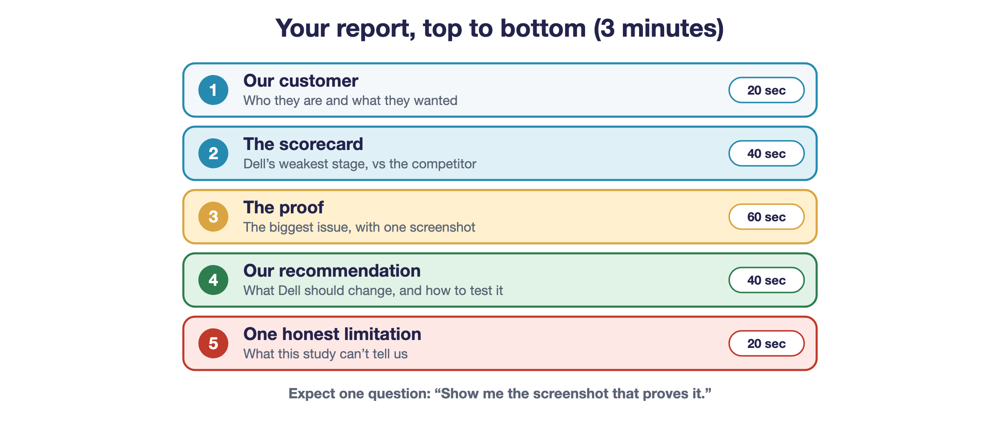

To share a run with your team, ask Codex for a clean copy:

💬 **Say to Codex:**

> Export a one-file report and a PDF of our latest run folder so I can share it with my team. Don’t show my key. Explain the result in non-technical words.

✅ **What should happen:** two new files appear in the run folder: `report-story.html` (one file that opens in any browser and can be emailed) and `report.pdf`. Check them against the screenshots before you rely on them.

🧠 **Take these with you.** Ask a good question, then keep asking. Guess first, then look. Check it, don't just trust it. They work with or without an agent. Pick one to use this week.

☑️ **Answer:** *What do we tell Dell?* One recommendation we would test with real customers, and one thing we are unsure about.

🎯 **The takeaway:** **A good recommendation says what to test next and what you're still not sure about.** Being honest beats sounding impressive.

## Your questions and answers

Tick each one when you can say the answer in your own words.

**Stage 1. Understand the job**

- [ ] **What does Dell want to know?**
- [ ] **What are the five parts of our agent?**
- [ ] **What is my agent not allowed to do?**

**Stage 2. Get ready**

- [ ] **Is my laptop ready?**
- [ ] **How does my agent get access to the AI?**
- [ ] **Who is our customer?**

**Stage 3. Watch it, then build a piece**

- [ ] **What does the AI do when it shops as our customer?**
- [ ] **How do we know if it did a good job?**
- [ ] **Can I make a piece of the agent myself?**

**Stage 4. Answer Dell**

- [ ] **Can the agent find a laptop on Dell?**
- [ ] **How does Dell compare with a competitor?**
- [ ] **Can we trust what it found?**
- [ ] **What do we tell Dell?**

### Team notes

- **What happened:**
- **Our recommendation and limitation:**
- **The habit I'll keep:**
